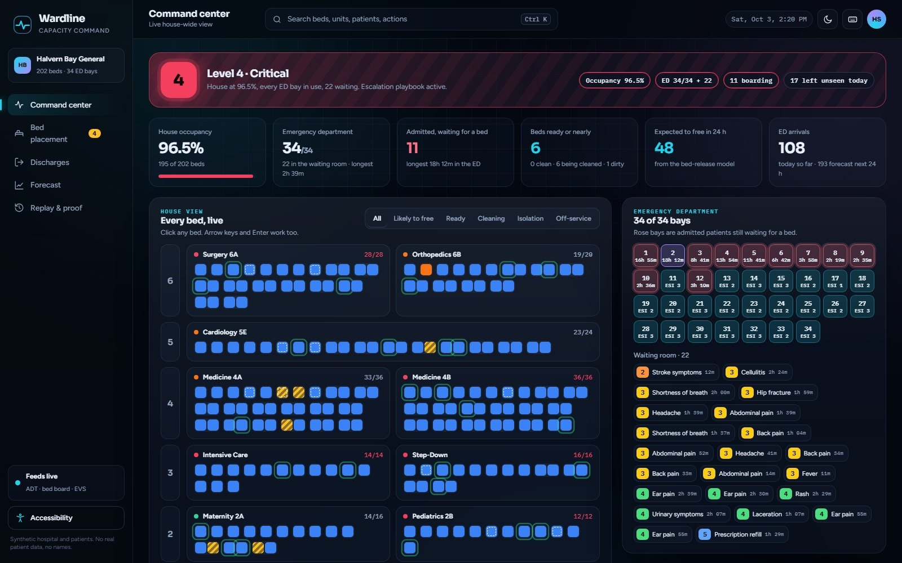
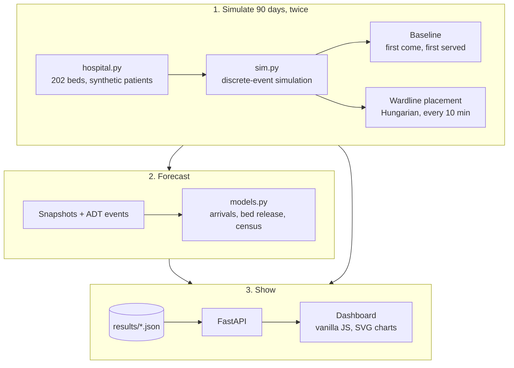

# Wardline

A bed management dashboard for a hospital: where every bed is, who is waiting for one, which beds will
free up soon, and which bed each waiting patient should get.

It runs on Halvern Bay General, a fictional 202-bed hospital with a 34-bay emergency department,
simulated for 90 days. Every patient is synthetic and has a number, an age and a sex, never a name.

**Same 90 days, same 15,417 patients: admitted patients waiting over 4 h for a bed drop from 20.7% to 15.9%.**



```bash
pip install -r requirements.txt
python run.py                          # ~40 s, simulates 90 days twice and fits the models
uvicorn wardline.api:app --port 8810   # dashboard at http://localhost:8810
pytest -q                              # 25 tests
```

## How it fits together



Every 10 minutes, and whenever a patient is admitted or a bed is cleaned, Wardline takes every waiting
patient and every bed that is clean or nearly clean, scores each pair and solves them all at once.
Isolation needs a single room, telemetry needs a telemetry bed, and shared rooms are single-sex. The
baseline is what a lot of hospitals still do by phone: first come, first served, into the first bed that fits.

Both runs replay the exact same patients (arrival, illness, length of stay, cleaning time), so the
placement policy is the only thing that changes.

## Results

From `results/summary.txt`:

| | First come, first served | Wardline |
| --- | --- | --- |
| Waited over 4 h for a bed | 20.7% | **15.9%** |
| Same, during the surge (last 10 days) | 38.5% | **32.1%** |
| Longest 10% of waits | 7.07 h | **6.55 h** |
| Placed on the wrong unit | 308 | **227** |
| Left the ED without being seen | 784 | **760** |

The forecasts are scored on days they never trained on:

| Model | Result | Baseline |
| --- | --- | --- |
| ED arrivals, next 24 h | 7.2% error | 4-week average 9.5% |
| Bed freed within 24 h | AUC 0.905, calibration error 1.3 pts | length-of-stay rule 0.706 |
| Census per unit, 48 h ahead | 2.71 beds off | "it stays the same" 3.01 |

## Limits

The hospital-wide census forecast beats "it stays the same" at 24 and 48 hours but only ties it at 72, and
it runs about 3 beds low. I tried a gradient-boosted arrivals model first. It did not beat the four-week
average, so the simpler model stayed. And this is a simulation, it has not seen a real hospital's ADT feed.

MIT licence. Synthetic data only, nothing here describes a real hospital or a real patient.
